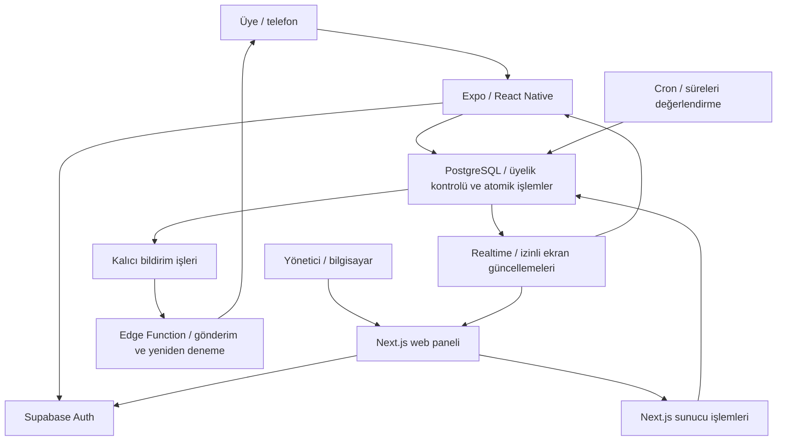

# ÇamaşırSırası — ürün, tasarım ve geliştirme planı

Tarih: 10 Ekim 2026  
Durum: Önerilen tasarım; henüz çalışan ürün veya açılmış servis yok.  
Geliştirme modeli: Tek geliştirici.  
Çalışma hedefi: Yapay zekâ desteğiyle 5 saatlik tek geliştirme oturumunda çalışan ilk sürüm.  
Kapsam: Ortak çamaşır makineleri bulunan yurtlar, apartmanlar, siteler, kampüsler ve işletmeler. Her mekân kendi alanını oluşturur; kullanıcılar davetle katılır.

Güncel platform ve üyelik kararı: Ayrı Expo/React Native mobil uygulama, Next.js yönetim web paneli ve ortak Supabase PostgreSQL. Ayrıntılar: [Katılım ve tasarım kararları](camasir-sirasi-katilim-ve-tasarim.md).

Kullanıcının onayladığı mobil hedefler: Android ve iPhone; ortak Expo/React Native kodu.

## 1. Ürünün temel kararı

ÇamaşırSırası, ortak çamaşır makineleri için rezervasyon ve kullanım sırasını yöneten, birden fazla mekâna hizmet veren bir uygulamadır. Kullanıcı arayüzünde mekânların oluşturduğu bölümlere **Alan** diyelim. Bu, Discord sunucusu benzeri bir üyelik ve yönetim alanıdır.

Her alanın sahibi, üyeleri, makineleri, programları, çalışma saatleri, yoğun saatleri ve kullanım kuralları vardır. Alanlar ortak uygulama altyapısında birbirinden ayrılmış verilerle çalışır. Mekân yöneticisinin teknik bir sunucu veya veritabanı kurması gerekmez.

Bir kişi birden fazla alana katılabilir: örneğin evindeki apartmanda üye, çalıştığı işletmede yönetici olabilir. Yetkisi her alan için ayrı belirlenir.

İlk sürümün veri modeli çok alanlı olacak; ilk saha denemesi tek çamaşırhanede yapılacak. Böylece üyelik ve veri ayrımını sonradan yeniden kurmadan, gerçek kullanım sorunlarını küçük bir pilotta çözeriz.

İlk ürün ortak çamaşır makinelerine odaklanır. İleride kurutucu eklenebilir. Toplantı odası, spor alanı gibi başka ortak kaynakların süre ve kullanım kuralları farklı olduğundan, genel rezervasyon platformuna genişleme ayrı bir ürün kararıdır.

## 2. Kim kullanacak ve ne yapabilecek?

| Rol | Yapabilecekleri |
| --- | --- |
| Alan sahibi | Alan oluşturma, ayarları değiştirme, yönetici atama, sahipliği aktarma, alanı arşivleme |
| Alan yöneticisi | Makine ve program yönetimi, davet oluşturma, üyelik taleplerini değerlendirme, arıza ve gecikmelere müdahale |
| Üye | Makineleri görme, rezervasyon yapma, sıraya girme, teklifi kabul etme, QR ile kullanım kaydı başlatma, çamaşırlarını aldığını bildirme |
| Platform yöneticisi | Uygulama sağlığı ve destek işlemleri; alan içi müdahaleler gerektiğinde açık yetki ve işlem kaydıyla |

Sahiplik için tek doğruluk kaynağı `spaces.owner_user_id` olur. Diğer üyeliklerde `admin` veya `member` rolü tutulur; sahibin rolü buradan türetilir. Sahip, devretmeden alanı terk edemez. Sahiplik devri aynı alanın aktif üyesine yapılır.

Üyeler başka kişilerin e-posta, telefon veya özel kullanım geçmişini görmez. Ortak ekranda makine durumu ve kendilerine ait sıra bilgisi gösterilir. Yöneticiye operasyon için gerekli alan verileri açılır.

## 3. Alan oluşturma ve katılma

**Alan sahibi akışı:**

1. Hesap açar ve e-postasını doğrular.
2. “Alan oluştur” seçeneğine basar.
3. Ad, mekân türü ve saat dilimini seçer.
4. İlk çamaşırhaneyi ve makineleri ekler.
5. Her makinenin program adını ve tahmini süresini girer.
6. Çalışma saatlerini ve başlangıç kurallarını belirler.
7. Süreli davet kodu veya bağlantısı oluşturup paylaşır.

**Üye akışı:**

1. Hesap açar veya giriş yapar.
2. Davet bağlantısını açar ya da kodu girer.
3. Alan adını ve kullanım kurallarını görür.
4. Katılma talebini gönderir.
5. Yönetici onayından sonra makineleri ve takvimi görür.

İlk sürümde davet için tek bir altyapı kullanalım: rastgele, yeterince uzun kod; son kullanma tarihi; kullanım sınırı; iptal edilebilme. Bağlantı aynı kodu taşır. Başlangıç önerisi: 7 gün geçerlilik ve 50 katılım talebi sınırı. Varsayılan üyelik yönetici onayına bağlıdır; bunlar ürün politikası önerileridir, pilotta değişebilir.

Kodu bilmek yöneticilik yetkisi vermez. Kod denemelerine hız sınırı uygulanır. Davetin ham değeri yerine hash değeri saklanır. Kullanım sayacı ve katılma talebi aynı veritabanı işleminde güncellenir; mevcut üyeler yeniden katılma işlemiyle hak çoğaltamaz.

Davet yalnız başvuru oluşturur. Üyelik onayı, yöneticinin bilinen sakin e-postasını doğrulanmış hesapla eşleştirmesine veya yetkili personelin yüz yüze/bilinen iletişim kaydı üzerinden kontrolüne dayanır. Kullanıcının yazdığı ad ve oda numarası tek başına sakinliği kanıtlamaz. Çıkarılmış/engellenmiş kişi yeni kodla kendi üyeliğini tekrar aktif yapamaz. İzinli dış kişiler yönetici onayıyla ve gerekirse süreli üyelikle kabul edilir. Resmî kurum doğrulama işaretini alan sahibi kendine veremez.

## 4. İlk sürümde bulunacak özellikler

| Özellik | İlk sürümdeki davranış |
| --- | --- |
| Hesap ve alanlar | Bir hesap, birden fazla alan üyeliği ve alan seçici |
| Makine listesi | Boş, kullanımda, çamaşırlar alınacak, kontrol gerekli, arızalı durumları |
| Rezervasyon | Makine, program ve uygun başlangıç saati seçimi |
| Kullanım başlatma | Makine üzerindeki QR + rezervasyon sahipliği kontrolü + kullanım onayı |
| Tahmini bitiş | Yönetici tarafından girilen program süresi ve gerçek başlangıç saatiyle hesaplama |
| Bekleme listesi | Program ve gelebileceği aralıkla sıraya katılma |
| Boşalan yere teklif | İlk uygun kişiye süreli teklif; kabul sonrası kısa geliş süresi |
| Gelmeyenin hakkını bırakma | Makine hazırken başlangıç toleransı dolarsa rezervasyonun sona ermesi |
| Dengeli kullanım | Alan bazında bir aktif hak, günlük kullanım sınırı ve yoğun saat kotası |
| Bildirimler | İlk oturumda uygulama içi bildirimler; cihaz push bildirimleri ek geliştirme olarak |
| Yönetici işlemleri | Üye onayı, makine kapatma, arıza ve gecikme yönetimi, gerekçeli müdahale |

Ödeme, ücretli abonelik, makineyi uzaktan çalıştırma, sensör entegrasyonu, yapay zekâ ile tahmin, herkese açık alan keşfi ve mağazalardaki ayrı mobil uygulamalar sonraki aşamalardır.

## 5. Kullanıcı deneyimi ve ekranlar

Telefon öncelikli, sade bir tasarım kullanacağız. Kullanıcının ana soruları “Ne zaman yıkayabilirim?”, “Sıram geldi mi?” ve “Çamaşırlarımı ne zaman alacağım?” olacak.

### Ekran yapısı

| Ekran | Görünecek içerik ve ana işlem |
| --- | --- |
| Giriş | E-posta, parola, e-posta doğrulama, parola sıfırlama |
| Alanlarım | Katıldığı alanlar, alan oluşturma ve davetle katılma |
| Çamaşırhane | Alan seçici, kendi aktif işlemi, makineler ve en yakın uygun saatler |
| Rezervasyon | Makine, program, süre, müsait saat ve son onay |
| Sıram | Rezervasyon veya bekleme talebi, teklif, başlatma ve iptal |
| Kullanım | Başlama saati, tahmini bitiş, sorun bildir ve çamaşırları aldım |
| Alan | Alan kuralları, üyelik bilgisi, bildirim ayarları |
| Yönetim web | Makineler, programlar, üyeler, davetler, kurallar ve sorunlar |

Mobilde alt gezinme: **Çamaşırhane / Sıram / Alan**. Üstte alan seçici. Yönetici ayrı web panelini kullanır; masaüstünde geniş tablo düzeni gösterilir. Mobil katılım başvurusu ve webdeki onay aynı üyelik kaydını günceller.

Makine satırı örneği: “Makine 02 · Kullanımda · Tahmini bitiş 18.50”. İkinci önemli örnek: “Makine 03 · Çamaşırlar alınacak”. İkinci durumda rezervasyon takvimi görülebilir ama “Hemen başlat” sunulmaz.

Durumlar renk, simge ve metin birlikte gösterilir. Önerilen görsel dil: açık zeminde koyu metin, yeşil veya turkuaz ana işlem rengi, uyarılar için amber, arıza için kırmızı; koyu tema karşılıkları ve yeterli metin kontrastı. Dokunma hedefleri en az 44 piksel, gövde metni yaklaşık 16 piksel olacak. Sayaç tek bilgi kaynağı olmayacak; son saat de yazacak.

İki ana ekran yaklaşımı karşılaştırılabilir: **Makine odaklı** düzen makine listesini öne çıkarır; **Sıra odaklı** düzen kullanıcının aktif işlemini öne çıkarır. İlk ürün için aktif işlemi üstte gösteren makine listesi dengeli bir başlangıçtır.

## 6. Sıra kuralları

Aşağıdaki sayılar başlangıç önerileridir. Her alan kendi kapasitesine göre değiştirebilir.

| Kural | Başlangıç önerisi |
| --- | --- |
| Rezervasyon ufku | Gelecek 24 saat |
| Aktif hak | Alan başına 1 rezervasyon, bekleme talebi, teklif veya devam eden kullanım |
| Günlük kullanım | Alan başına kişi başı en fazla 2 onaylanmış kullanım hakkı |
| Yoğun saat kullanımı | Alanın yerel gününde kişi başı en fazla 1 hak |
| Başlama toleransı | Makine hazır olduğunda 5 dakika |
| Çamaşırları alma tamponu | 10 dakika |
| Teklif kabul süresi | 2 dakika |
| Teklif kabulünden sonra geliş | 5 dakika |

**Rezervasyon bloğu:** Seçilen program süresi + başlangıç toleransı + teslim alma tamponu. Örneğin 45 dakikalık bir program için 60 dakikalık blok ayrılır. Kullanıcı 18.00'de başlarsa tahmini bitiş 18.45; 18.05'te başlarsa 18.50 olur. 19.00'a kadar olan blok, gecikme ve teslim alma için yer bırakır. Makinenin daha erken boşaldığı doğrulanırsa uygun bekleme talebine teklif verilebilir.

**Kotanın tüketimi:** Onaylı rezervasyonlar ve kabul edilmiş teklifler hakkı ayırır; tamamlanan veya kabul edildikten sonra kullanılmayan haklar günlük/yoğun saat sayımında kalır. Zamanında iptal, makine arızası ve yönetici kaynaklı iptal hakkı geri verir. Bekleme listesine yazılmak veya cevaplanmamış teklif tek başına günlük kotayı tüketmez. Böylece kişi iptal-et-yeniden-al yoluyla yoğun saat sınırını aşamaz. Yoğun saat sınıflandırması ayrılan zaman bloğunun yoğun aralıkla çakışmasına göre yapılır.

**Adalet:** Uygun bekleyenler arasında ilk giren ilk değerlendirilir. Programı boşluğa sığmayan veya o saatte gelemeyen kişi sırasını kaybetmez. Kotası dolan kişiye yeni hak sunulmaz. Başlamış kullanım kesilmez; onaylı rezervasyonlar adalet gerekçesiyle sessizce başka kişiye verilmez.

Bekleme talebi, ona verilen geçici teklif ve kabul edilmiş rezervasyon aynı mantıksal hakkın aşamalarıdır. Bir aktif hak kontrolü bunları üç ayrı hak saymaz; aynı kişinin başka makinede ikinci hak oluşturmasını da engeller. Günlük kotanın tarihi rezervasyonun planlanan başlangıcının alanın yerel tarihine sabitlenir; gece yarısından sonra bitiş veya gecikmiş başlama sayımı başka güne taşımaz.

**Gelmeme:** Kullanıcının başlatma onayı yoksa ve makine gerçekten kullanılabilir durumdaysa başlangıç toleransı sonunda hakkı bırakılır. Önceki kullanıcının çamaşırları içerideyse, makine arızalıysa veya uygulama kaynaklı erişim sorunu doğrulanmışsa kişi gelmedi sayılmaz. Makine geç hazır olduğunda uygulamada yeni hazır olma zamanı kaydedilir ve geliş toleransı buna göre işler. İlk pilotta ayrıca otomatik hesap cezası uygulamayalım; kayıt ve uyarı yeterli.

Gecikmiş başlangıç programı sonraki onaylı rezervasyona taşıracaksa otomatik başlatma verilmez: başka makine/saat veya hak kaybı olmadan iptal önerilir. Yönetici bir gecikmeyi çözerken etkilenen rezervasyon değişikliğini açıkça bildirir. Zamanında iptal için başlangıç önerisi, ayrılan saatin en az 10 dakika öncesidir; daha geç iptal gelmeme kaydından ayrı tutulur fakat ayrılmış günlük hakkı geri vermez.

**Teklif:** Aynı boşluk aynı anda tek kişiye teklif edilir. Teklif kabul edilmezse sonraki uygun kişiye geçilir. Kabul edilmiş teklif rezervasyona dönüşür, aynı kullanıcının bekleme talebi kapanır. Süresi dolan teklif, arka plan görevi henüz çalışmamış olsa da kabul edilemez.

Teklif oluşturulunca ilgili zaman aralığı rezervasyon tablosunda geçici olarak tutulur; kabulde aynı kayıt onaylı duruma geçer. Böylece takvimden doğrudan rezervasyon isteyen biri, başka kişiye hâlâ teklif edilmiş boşluğu alamaz. Teklif ve kesin rezervasyon aynı çakışma denetimini kullanır.

**Boşluğa sığma:** Teklifin son kabul anı + geliş süresi + program + teslim alma tamponu, sonraki onaylı rezervasyondan önce tamamlanmalıdır. Örneğin 18.05'te verilen teklif 18.07'ye kadar kabul edilebilir, kişi 18.12'ye kadar gelebilir. Sonraki rezervasyon 19.00 ise 30 dakika program + 10 dakika tampon sığar; 45 dakika program sığmaz. Kısa boşluk uygun program yoksa boş kalır; başka kişinin onaylı saati kaydırılmaz.

Teklifin geçici bloğu teklif zamanında başlar; sonu son kabul zamanı + geliş süresi + program + teslim alma tamponudur. Teklif kabul edilince başlatma son zamanı kabul anı + 5 dakika olur. Normal rezervasyonun başlangıç toleransı buna ikinci kez eklenmez. Bütün kullanım ve teslim alma planı çamaşırhanenin kapanışından önce de bitmelidir; sınır, sonraki rezervasyon ile kapanıştan erken olanıdır.

Makine gecikirse sonraki kullanıcıya yeni tahmin ve varsa başka makine seçeneği sunulur. İlk sürümün dinamik sıralaması esas olarak boşluklar ve bekleme listesi üzerinde çalışır; bütün günün takvimini sürekli değiştirmez.

## 7. Fiziksel makine ve dijital durum

QR, ilk sürümde kullanım kaydını başlatır. Makine programını kullanıcı fiziksel panelden çalıştırır. Sensör veya üretici entegrasyonu olmadığı için uygulama elektronik olarak programın başladığını veya bittiğini kesin bilemez. Sabit QR'nin fotoğrafı kopyalanabilir; QR tek başına kişinin makinenin yanında olduğunun kanıtı değildir.

| Makine durumu | Anlamı |
| --- | --- |
| Boş | Son kullanımdan sonra boşalma onaylandı |
| Kullanımda | Kullanıcı kullanım başlatma kaydı verdi |
| Çamaşırlar alınacak | Tahmini süre geçti; boşalma henüz doğrulanmadı |
| Kontrol gerekli | Kullanıcı beyanları çelişkili veya durum bilinmiyor |
| Arızalı | Yönetici yeni kullanımları kapattı |

“Tahmini bitiş” makinenin boş olduğu anlamına gelmez. “Çamaşırlarımı aldım” onayı veya yönetici kontrolü sonrası makine boş olur. Kullanıcı QR sonrası “Makine dolu” bildirirse otomatik başlatma yerine sorun akışı açılır. Başka kişinin çamaşırlarını kaldırma kararı uygulamadan verilmez; mekânın operasyon kuralı uygulanır.

Rezervasyonun durumu ayrıca tutulur: `onaylı → başladı → tamamlandı`; alternatif son durumlar `iptal`, `gelmedi`, `yönetici iptali`. Bekleme talebi ve tekliflerin de kendi süreleri ve durumları vardır.

## 8. Teknoloji ve platform seçimi

**Öneri: Expo/React Native mobil uygulama + Next.js yönetim web paneli + TypeScript + Supabase.** Telefona kurulan mobil uygulama ve yönetim webi aynı hesap/veritabanı altyapısını kullanır. Bu bir mühendislik önerisidir; sağlayıcıların plan limitleri yayına çıkmadan değerlendirilir.

| Katman | Seçim | Görevi |
| --- | --- | --- |
| Ana dil | TypeScript | Arayüz, sunucu uçları ve bildirim fonksiyonları |
| Mobil arayüz | React Native / Expo | Android ve iPhone uygulaması |
| Web arayüz | React / Next.js + shadcn/ui | Yönetici paneli |
| Stil | Native stil değerleri; webde Tailwind CSS | Ortak renk ve boşluk sistemi; platforma uygun bileşenler |
| Web sunucu işlemleri | Next.js Route Handlers | Giriş doğrulaması, istek doğrulaması ve güvenli işlemler |
| Veritabanı | Supabase PostgreSQL | Alanlar, üyelikler, makineler, sıra ve geçmiş |
| İkinci dil | SQL; gerektiğinde PL/pgSQL | Veri modeli, erişim politikaları, atomik rezervasyon işlemleri |
| Hesap | Supabase Auth | E-posta/parola, doğrulama ve parola sıfırlama |
| Canlı ekranlar | Supabase Realtime | Makine ve kullanıcının kendi işlem durumunu yenileme |
| Zamanlı işler | Supabase Cron | Süresi geçen kayıtların ortak görevle değerlendirilmesi |
| Bildirim gönderimi | TypeScript Edge Function | Kalıcı bildirim kuyruğundaki işleri gönderme ve yeniden deneme |
| Web dağıtımı | Vercel | Next.js uygulamasını yayınlama |
| Mobil paketleme | Expo EAS | Telefonda test ve mağaza paketleri |
| Kaynak yönetimi | Git / GitHub | Değişiklikler, görevler ve yayın kontrolü |

Expo'nun resmi rehberi React Native uygulamasına Supabase PostgreSQL ve kullanıcı doğrulaması bağlamayı açıklıyor. Native ve web uygulama aynı veri katmanını kullanır; kullanıcı ve alan üyelikleri iki ayrı sistemde çoğaltılmaz. [Expo / Supabase rehberi](https://docs.expo.dev/guides/using-supabase/)

Mobil QR tarama kamera izniyle çalışır. Kamera izni verilmezse makine kodu girme akışı sunulur. Bu yöntem de rezervasyon ve üyelik kontrolünden geçer. Katılım QR'ı ve makine QR'ı farklı türlerdir; makine QR'ı üyelik vermez.

Çevrimdışıyken son görülen bilgiler “güncel değil” etiketiyle gösterilebilir; rezervasyon kabulü, teklif kabulü ve kullanım başlatma için bağlantı gerekir. Mağaza dağıtımı geliştirici hesabı ve imzalama gerektirir; çalışan ilk sürüm ile mağaza yayını ayrı sonuçlardır. [Expo build rehberi](https://docs.expo.dev/build/setup/)

## 9. Sistem nasıl çalışacak?

Kritik sıra kuralları PostgreSQL işlemlerinde tek yerde bulunur. Mobil, Next.js ve zamanlı görevler aynı kuralları çağırır. İstemciye güvenilerek rezervasyon verilmez. Realtime ekranı günceller; kullanım hakkını vermez.

Her rezervasyon, teklif kabulü ve başlatmada alan üyeliği, rol, kota, süre, makine ve çakışma yeniden doğrulanır. Aynı makineye eşzamanlı gelen iki istekten yalnızca biri başarılı olur. Kilitler ve veritabanı kısıtları birlikte kullanılır. PostgreSQL zaman aralığı ve exclusion constraint yaklaşımı, aynı kaynağın çakışan rezervasyonlarını engellemek için uygundur. [PostgreSQL kısıtları](https://www.postgresql.org/docs/current/sql-createtable.html)

Makineye ek olarak alan-kullanıcı düzeyinde ortak kilit/kontrol gerekir; aynı kişi iki farklı makineye eşzamanlı istekle ikinci aktif hak alamaz. Boşalma onayı ve uygun bekleyene geçici teklif oluşturma aynı işlemde yapılır. Eski bir kullanıcının gecikmiş “çamaşırlarımı aldım” isteği yeni kullanım oturumunu boşaltamaz; makinenin güncel oturum kimliği doğrulanır.

Tekrarlanan başlatma, kabul veya bitirme isteği ikinci işlem üretmez. Zamanlar veritabanı saatine göre karşılaştırılır. Her rezervasyon için ayrı sayaç görevi yerine, örneğin dakikada bir tüm alanlardaki süresi geçen kayıtları tarayan görev kullanılır. Cron'un gecikmesi geçmiş bir teklifi geçerli yapmaz. [Supabase Cron](https://supabase.com/docs/guides/cron)

Bildirim kayıtları durum değişikliğiyle aynı işlemde kalıcı kuyruğa yazılır. Gönderim başarısızsa tekrar denenir; uygulama içi kaydı kalır. Kuyruk gönderiminden önce teklifin hâlâ geçerli olduğu kontrol edilir. [Supabase Edge Functions](https://supabase.com/docs/guides/functions)

## 10. Temel veri modeli

| Tablo | Temel alanlar ve amaç |
| --- | --- |
| `profiles` | Kullanıcı kimliği, görünen ad; kimlik doğrulama Supabase Auth'ta |
| `spaces` | Ad, mekân türü, sahip, saat dilimi, aktif/arşivli durumu |
| `memberships` | Alan, kullanıcı, admin/member, bekliyor/aktif/reddedildi/çıkarıldı/engellendi durumu, onaylayan ve varsa bitiş zamanı |
| `invitations` | Alan, kod hash'i, son kullanım zamanı, kullanım sınırı, iptal bilgisi |
| `laundry_rooms` | Alan içindeki fiziksel çamaşırhane; MVP arayüzünde alan başına bir tane |
| `machines` | Alan ve çamaşırhane, kod, durum, QR kimliği |
| `programs` | Makine, program adı, tahmini dakika, aktif durumu |
| `space_rules` | Çalışma saatleri, yoğun aralıklar, kotası ve toleranslar |
| `reservations` | Alan, üye, makine, program, ayrılan aralık, geçici teklif/onaylı durum ve süre anlık görüntüsü |
| `usage_sessions` | Rezervasyon, gerçek başlatma, tahmini bitiş, boşalma onayı |
| `waitlist_entries` | Alan, üye, uygun makine/program, gelebileceği aralık, sıraya giriş zamanı |
| `offers` | Bekleme talebi, geçici rezervasyon kaydı, son kabul zamanı, durum |
| `notifications` | Kullanıcıya ait uygulama içi bildirim |
| `notification_jobs` | Gönderim kuyruğu, deneme sayısı ve sonuç; istemciye kapalı |
| `issue_reports` | Makine veya kullanım sorunu, durum ve yöneticinin çözümü |
| `audit_logs` | Yönetici müdahalesi, gerekçesi ve zamanı; üyelerin yazmasına kapalı |

Alan verilerinde `space_id` bulunur. İlişkiler bir alandaki rezervasyonun başka alandaki makine, program veya üyeliğe bağlanmasına izin vermez. `(space_id, user_id)` üyelikte tekildir. Alan sahibinin aktif üyeliği korunur.

Rezervasyon sırasında program süresi ve tamponlar kayda alınır; yönetici programı sonradan değiştirince mevcut rezervasyonun süresi kendiliğinden değişmez. Tüm anlar UTC olarak saklanır, alanın saat diliminde gösterilir. Günlük kota alanın yerel gününe göre hesaplanır.

## 11. Alanların verisini ayırma

Çok alanlı yapıda temel erişim kuralı: **Kullanıcı yalnızca aktif üyesi olduğu alanın izinli bilgilerine erişebilir.** Adres çubuğundaki alan kimliğini değiştirmek erişim vermez.

Supabase'te tablo yetkileri ve RLS politikaları birlikte tanımlanır. Makine özetleri alan üyelerine açılır; kişisel rezervasyonlar ve bildirimler sahiplerine, gerekli operasyon kayıtları aynı alanın yöneticilerine açılır. Rol verisi kullanıcı tarafından değiştirilebilen profil alanından okunmaz. Üye kendi rolünü yükseltemez. [Supabase RLS](https://supabase.com/docs/guides/database/postgres/row-level-security)

Realtime akışları da üyeliğe ve veri görünürlüğüne uyar. Gizli sunucu anahtarları tarayıcıya gönderilmez. Ayrıcalıklı arka plan işlemleri dar amaçlarla çalışır. Yeni tablolara erişimin otomatik verilmesini varsaymayız; gerekli erişim açıkça tanımlanır. [Supabase Data API erişimi](https://supabase.com/changelog/45329-breaking-change-tables-not-exposed-to-data-and-graphql-api-automatically)

Üyelikten çıkarılan kişinin gelecekteki rezervasyonları, bekleme talepleri ve teklifleri kapanır. Devam eden fiziksel yıkama kesilmez; yönetici kontrolüne geçer. Alan arşivlenirken aktif yıkamalar güvenli biçimde sonlandırılır, yeni hak verilmez. Kullanıcı veri silme ve kayıt saklama davranışları yayından önce ürün politikası olarak belirlenir.

## 12. Beş saatlik geliştirme oturumu

Kullanıcının belirlediği hedef: Tek geliştirici ve yapay zekâ desteğiyle, 5 saatlik bir oturumda profesyonel görünümlü ve temel akışları çalışan ilk sürüm. Aşağıdaki süreler çalışma bütçesidir; tamamlanmış ürün iddiası veya kesin teslim garantisi değildir. Hazırlanan ekran yaklaşımı üzerinden tek kod tabanında ilerleyeceğiz.

| Çalışma aralığı | Odak | Ortaya çıkacak sonuç |
| --- | --- | --- |
| 0:00–1:00 | Uygulama temeli ve alanlar | Mobil arayüz, hesap, alan oluşturma, davet, üyelik ve yetkiler |
| 1:00–2:00 | Makineler ve rezervasyon | Programlar, uygun saatler, çakışma ve kişi başına aktif hak kontrolü |
| 2:00–3:00 | Kullanım akışı | QR/kod, başlatma, tahmini bitiş, teslim alma ve yönetici müdahalesi |
| 3:00–4:00 | Sıra devri | Bekleme, süreli teklif, gelmeme, yoğun saat kotası ve uygulama içi bildirim |
| 4:00–5:00 | Son düzenleme ve doğrulama | Görsel tutarlılık, iki hesapla tam akış, alan ayrımı ve eşzamanlı rezervasyon kontrolü; yayın yapılandırması |

Oturumun bitiş ölçütü: Bir kişi alan açar, ikinci kişi katılır, makine eklenir, rezervasyon yapılır, kullanım kaydedilir ve makine boşalınca uygun bekleyen kullanıcıya teklif gider. Aynı alanın iki hesabıyla bu akış, ikinci test alanıyla veri ayrımı ve eşzamanlı istekle çakışma kontrol edilir. Mobil ekranlarda yükleniyor, boş, hata ve başarılı işlem durumları tamamlanır.

Profesyonel ilk sürümün kapsamı bu çekirdek akıştır. Cihaz push bildirimleri, gelişmiş kurum raporları, ödeme ve donanım entegrasyonu ek geliştirmelerdir. Yayın için hesap, ortam değişkenleri ve sağlayıcı bağlantıları hazırlanır; yayın durumunu ancak gerçek dağıtım doğrulandıktan sonra tamamlandı olarak bildiririz.

Uygulama dilleri TypeScript ve SQL olacak. Mevcut tasarımı kullanarak doğrudan çalışan akışlar üzerinden ilerleyeceğiz.

Proje tek depo içinde tutulur: ayrı mobil ve yönetim web uygulamaları; ortak alan/üyelik, makine ve rezervasyon tipleri; SQL migration'ları; bildirim fonksiyonları. Geliştirme ortamı ve canlı ortam ayrı olur; sürümler kilitlenir, veri modeli değişiklikleri migration ile takip edilir.

## 13. Yayından önce gerçekten doğrulanacak durumlar

1. Aynı makine ve zamana aynı anda rezervasyon isteyen iki kişiden yalnızca biri başarılı olur.
2. A alanının üyesi B alanının makine, rezervasyon ve Realtime verilerini alamaz.
3. Üye kendisini yönetici yapamaz; yöneticinin işlemi de kendi alanıyla sınırlıdır.
4. Süresi dolmuş veya iptal edilmiş davet kabul edilemez; davet kullanım sınırı yarışta aşılamaz.
5. Süresi dolmuş teklif Cron gecikse bile kabul edilemez.
6. Tahmini bitiş makineyi otomatik boşaltmaz; önceki çamaşırlar varken sonraki kişi gelmedi sayılmaz.
7. Bildirim gönderimi başarısız olduğunda işlem kaybolmaz, aynı hakkı iki kişiye vermez.
8. Günlük ve yoğun saat kotası rezervasyon, teklif ve iptal akışlarıyla aşılamaz.
9. Arıza ve üyelikten çıkarma, gelecekteki hakları kapatırken çalışan fiziksel makineyi kesmez.
10. Android ve iPhone uygulamasında giriş, kamera/kod alternatifi ve izin akışları; ayrı webde yönetici onayı denenir.
11. Aynı kişi iki farklı makineye eşzamanlı istekle iki aktif hak alamaz; bekleme-teklif-rezervasyon dönüşümü tek hak olarak kalır.
12. Eski oturumun bitirme isteği yeni oturumu etkilemez; gece yarısı kotayı ve kapanış sınırını bozmaz.

Bunlar planlanan kabul testleridir; bu tasarım dokümanında çalışan uygulama testi yapıldığı iddia edilmez. Özellikle yarış koşulları ve alan ayrımı gerçek veritabanı entegrasyon testleri gerektirir.

## 14. Pilotta neyi ölçeceğiz?

- Kullanım için yapılan gereksiz fiziksel kontrol ziyaretlerinin kullanıcı görüşmeleriyle değişimi.
- Onaylı rezervasyonlar içindeki gelmeme oranı.
- Boşalma onayından sonraki yeni kullanım başlangıcına kadar geçen süre.
- Teklif kabul oranı ve kabulden sonra kullanım başlangıcı oranı.
- Tahmini bitiş sonrası çamaşırları alma gecikmesi.
- Yoğun saat kullanımının kişiler arasında dağılımı.
- Makine dolu, arıza ve yönetici müdahalesi sayısı.

Donanımdan program bitişi okunmadığı için kullanıcı tarafından kaydedilen kullanım zamanı ile makinenin elektronik program süresi ayrı kavramlardır. Başarı hedeflerini ilk gerçek kullanımlardan temel ölçümü aldıktan sonra belirleriz.

## 15. Sonraki sürümler

1. Bir alan içinde birden fazla çamaşırhane ve kurutucular.
2. Birden fazla mekânı işleten kuruluşlar için ortak yönetim.
3. Geçmişten daha iyi süre tahmini; yeterli veri varsa değerlendirme.
4. Dinamik QR veya donanım/üretici entegrasyonu.
5. Mekân başına abonelik, ödeme ve kurum raporları.
6. Mobil yönetici işlemleri ve ek kurumsal entegrasyonlar.

İlk uygulama hedefi: **Alan aç → üye katılsın → makine eklensin → rezervasyon yapılsın → kullanım doğrulansın → makine boşalsın → uygun bekleyene teklif gitsin.**
